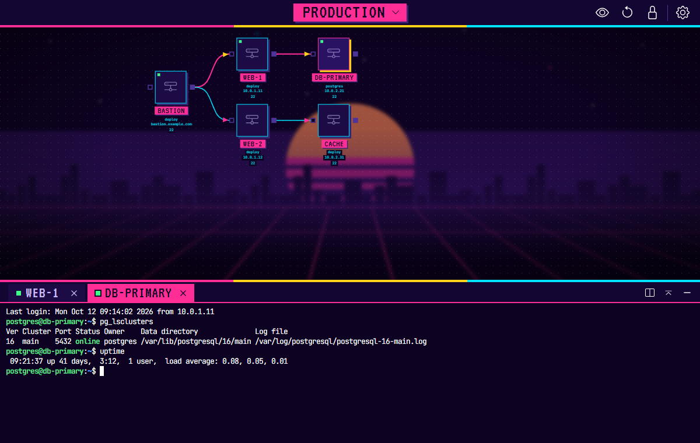

# jumpspace

The visual SSH connection editor. **Draw your servers, chain them into jump-host paths and open the right `ssh` session with one click, in terminals inside the app.**



(The servers in the picture are made up.)

note: Windows only for now (it needs Git for Windows)

## features

- Draw your servers as nodes and chain them into jump-host paths.
- One click opens the right `ssh` command in a terminal inside the app (or, if you prefer, in a Git Bash window): to a single node, through the whole chain (ProxyJump), or as port forwards.
- Every node has its own authentication (key, password, both, or neither), so one path can mix them.
- Port forwarding is set up on the node itself, also through several hops.
- Terminals belong to the diagram they were opened from, and the diagram shows the state of every session on its path (connecting, connected, failed). The terminal panel can be split left and right, maximized or minimized to its tab row.
- Copy any node as `~/.ssh/config`, or make nodes out of pasted `~/.ssh/config` text.
- Pick an icon for each node from a grid. The canvas position and zoom of each diagram are remembered.

## requirements

1. [Git for Windows](https://gitforwindows.org/) (To install Git Bash)
2. OpenSSH >= 7.6 (Installed together with Git Bash). Password sign-in needs OpenSSH >= 8.4 (`SSH_ASKPASS_REQUIRE`), which current Git for Windows ships.

## trying it on Windows

There is no release yet, but the CI can build a Windows installer on request: under *Actions*, open the *CI* workflow and choose *Run workflow* on this branch (GitHub sign-in needed), then download the artifact `jumpspace-windows-installer` from that run and run the `.exe` inside the zip. Ordinary pushes do not build it. It is unsigned, so SmartScreen asks first (*More info* > *Run anyway*). It installs for the current user without asking where. Or build it yourself:

1. Install [Git for Windows](https://gitforwindows.org/) and [Node.js](https://nodejs.org/) 22 (LTS).
2. In Git Bash or PowerShell:
   ```sh
   git clone -b claude/cool-bardeen-9x9ymz https://github.com/scissorstail/jumpspace.git
   cd jumpspace
   npm ci
   npm run dev      # starts the app directly, or:
   npm run dist     # builds the installer into dist_electron\
   ```
   `node-pty` (the in-app terminal) ships prebuilt for Windows, so no Visual Studio is needed.
3. Open *Settings* (gear in the header) and check *Git Bash path*; the default is `%ProgramFiles%\Git\git-bash.exe`.

## usage

### nodes and paths

1. Click the title in the header (it shows `jumpspace` until a diagram is open) to open the list of diagrams, add a diagram with `+` and give it a name.
2. Unlock the editor (lock icon), right-click the canvas and choose *Add node* (or *From SSH config* to make nodes out of pasted `~/.ssh/config` text, see below), and chain nodes (jump hosts) with two clicks: click a node's right socket (the line follows the mouse), then click another node's left socket. A click on empty canvas cancels. Clicking a connected left socket picks its line up again. A link can be started at a left socket that has none, too, and is then finished with a click on a right socket. A link that would close a circle of nodes is not made, and a hint says so: the paths of a diagram with a loop cannot be worked out. A diagram that already has such a loop (drawn with an older version, or from a file) opens as it is, with a message that names the nodes of the loop; take one of those links away.
3. Hover a node to open its menu:
   - terminal: **Connect** runs `ssh` to the node in a terminal tab of the app (or in a Git Bash window, see *Settings > Open SSH in*). When the node has previous nodes and every one of them has a user, host and port, it is **ProxyJump** instead, which connects through the whole chain.
   - link: **Port forwarding**, see below. The button with a counter next to it starts the enabled forwards.
   - gear: **Node settings** (icon picked from a grid, name, user, host, port, key, password, exec) and *Copy SSH config*. A value that ssh would not accept gets a red border while you type; the note on what is allowed shows under the field while it has the focus or the pointer. While the editor is locked the popover is for reading: it shows only the fields that are filled in, without the icon grid.
4. The canvas position and zoom of each diagram are remembered and restored when you open it again. The diagram follows the height of the canvas, like the scenery behind it: it is shown smaller while the terminal panel is open and comes back by the same ratio when the panel is closed (a minimized panel still takes the height of its tab row), whichever of the two canvases you changed the zoom in. A change of the width alone leaves its size as it is. Double-click the canvas to bring back the starting zoom and position, like the **Reset view** button in the header (in a locked diagram a double-click on a node counts as the canvas too; on a line or a button it does nothing). With the terminal panel open you see the starting view reduced like every other view, and it is exactly the starting view when the panel closes. The starting view is the same in a window of every size: unlike a view you chose it does not grow and shrink with the height of the window, so **Reset view** after resizing the window gives what you already see. Lock the editor to save changes to the diagram; while a save runs, a faint ring turns in the header left of the buttons. A node under the pointer changes its frame and background color; a node you clicked gets no look of its own. You can start connections while it is locked. In a locked diagram the nodes cannot be moved, so a drag that starts on a node (its picture, name, details or sockets) moves the canvas like a drag on the background; only the buttons above a node take clicks.
5. The eye button left of the lock masks the details under every node (user, host, port, forwards) with `***` (an address becomes `***.***.***.***`) and keeps only the names, for example while sharing the screen; click it again to show them. The choice is remembered.
6. The lock is always the button right next to the gear menu; the other diagram buttons come and go to its left, so it stays under the pointer when you press it. **Reset view** (counterclockwise arrow), left of the lock and there whether the editor is locked or not, brings back the starting zoom and position. While the editor is unlocked, **Arrange nodes** (tree icon) shows left of it and lines all nodes up in the middle of the visible canvas, each path left to right on its own row, and zooms out if they do not fit (with the terminal panel open it keeps to the middle part of the canvas, so that nothing is cut off at the sides when the panel closes and the diagram grows again). Lock the editor to keep the new positions.
7. What you change while the editor is unlocked (nodes, links, settings of a node) is saved when you lock it again. Closing the window, reloading or quitting while it is still unlocked asks first: *Discard changes* or *Cancel*. Closing to the tray does not ask, nothing is lost there.
8. The window opens at the size and place it had, and maximized if it was. If that place is on no screen any more (a monitor that was unplugged), it starts at the default size in the middle.
9. With *Settings > Close to tray* on, closing the window only hides it: jumpspace and its terminals go on running in the tray (still logged in, so a tmux there stays attached), and a double-click on the tray icon brings the window back with its tabs. *Quit* in the tray menu ends the app and every terminal; while terminals are running it asks first (*Quit* or *Cancel*, Cancel is the default). With the setting off, closing the window ends the app and its terminals.

The node menu also shows when one of its buttons has keyboard focus. Enter opens a popover and moves the focus into it; Escape closes it and returns the focus to its button. Right-click a node for **Duplicate** or **Delete** (a node with content asks first). *Settings* and *Show Info* (gear menu in the header) open with the focus inside; Tab stays in them and Escape closes them. In *Settings*, Enter in the *Git Bash path* field saves like the Save button.

*Exec* is a command that runs on the server after login, the shell stays open afterwards.

### terminals

Connect, ProxyJump and port forwarding open in a **terminal panel at the bottom of the app**, one tab per session. **Terminals belong to the diagram that opened them**: the panel shows only the tabs of the open diagram, and so does the canvas with their paths. Opening another diagram puts them out of sight but keeps the sessions running; they are back, with the same tab in front, when you open their diagram again, and the diagram list shows how many each one has. Removing a diagram closes its terminals. Password prompts are answered as described below; anything else (a key passphrase, a one-time code, host key questions) is typed into the tab. The dot on a tab shows the state like the path on the canvas (yellow while connecting, green once logged in, grey when ended); it turns red when the session ended with an error, and its tooltip names the session, gives the exit status and says through how many previous nodes it runs (the name of a tab is the name of its node, nothing else). A tab is as wide as its name (long names are cut at about 220px); with many tabs they first get narrower, then the tab row scrolls (also with the mouse wheel) and keeps the active tab in view. Tabs with the same name (the same node opened twice) get a number after it, `web (1)`, `web (2)`, in the order they were opened; the number stays readable when the name is cut off. Drag a tab by its name to change the order of the tabs. A session you end yourself (`exit` or `logout` after logging in, Ctrl+C while connecting or on a forwarding tab) closes its tab right away. A tab whose connection failed or broke (ssh's own error, exit status 255, or an end before logging in) stays so you can read why, and can be reconnected with Enter in the terminal: the same connection starts again in the same tab. Closing a tab (its x, or a middle click on the tab) ends its ssh session. The buttons at the right end of the tab row are for the panel itself. The first **splits** it left and right, so two terminals are in sight at once: the selected tab stays in the left half and the tab next to it comes into the right half. The tab row stays one row; the selected tab has its usual color and the tab of the other half a frame in the same color. A click into the other half (or on its tab) moves the keyboard there, a line over that half shows where it is, and a tab that is not in sight replaces the tab of the half that has the keyboard, as does a new terminal. The same button, or closing one of the two tabs, ends the split, and each diagram remembers its own. The halves are equally wide. The next button **maximizes** the panel: the panel goes up to the header and the terminals take the place of the canvas; the same button brings the canvas back with the panel at its old height (the diagram buttons in the header are away meanwhile). The dash **minimizes** the panel while the sessions keep running: only the tab row stays, at the bottom of the window, and the canvas has the rest. A click on a tab, or on the same button (now an arrow up), shows the terminals again (maximized, if they were). Drag the top edge of the panel to resize it; it stops where the canvas would get too low, and dragged further up towards the header it snaps to the maximized size (drag the edge down again to let go). Each diagram remembers whether its panel is maximized, and closing the last tab ends it. Copy with Ctrl+C, Ctrl+Shift+C or Ctrl+Insert (or select and right click), paste with Ctrl+V, Ctrl+Shift+V, Shift+Insert or a right click; Ctrl+C with nothing selected is sent to the remote program. While a program uses the mouse itself (tmux with `mouse on`, vim, Claude Code) a right click goes to that program; hold Shift for the terminal's copy and paste. Ctrl with + or - makes the text of all terminals bigger or smaller (8 to 32 px) and Ctrl+0 puts it back to 13; the size is remembered. Ctrl+Shift+F finds text in what has scrolled by (text selected in the terminal is taken as the text to find): Enter goes to the match before, Shift+Enter to the next one, Esc closes. *Show Info* in the gear menu lists these keys. The path of every session shows its state on the canvas, standing still: its connections get thicker and take the color of the state, and its nodes get a small dot. The states are **connecting** (yellow line and arrow, a yellow dot) until ssh has logged in, **connected** (the line in the palette's main color with the arrow in a second color, a green dot on its nodes), and **failed** (red dashed line and a red dot) when it could not start or ssh itself failed; the red stays until the tab is closed or reconnected, a normal end clears the path. **The node the selected tab was opened from is marked** (pink frame, the shadow in the palette's sun color), so you can see on the diagram which server the terminal in front belongs to; selecting another tab moves the mark, and it is gone while the panel is minimized.

*Settings > Open SSH in* switches back to opening a separate **Git Bash window** instead.

**Known problem on Windows: a new terminal size and Git's ssh.** When the terminal changes its size (the panel is dragged, maximized or lowered, the window is resized), the ssh of Git for Windows sometimes does not pass the new size on to the server. A full-screen program then keeps the old size until the next key or output; the key typed after such a change is sometimes swallowed, and sometimes ssh ends with `poll: No error` and the connection is closed. Measured on Windows 10 with Git for Windows 2.55 (OpenSSH 10.5p1): between one and six of ten size changes were not passed on, and about one in six of those ended the session at the next key. It happens inside Git's ssh when it runs in a Windows console, with the console layer of Windows as well as with the bundled one, and the app has no way around it; the ssh that comes with Windows did not show it in the same test. It is left as it is for now. When a full-screen program is still drawn for the old size after a size change, change the size once more (drag the edge of the panel a little, or maximize and lower it): every change is a new attempt to pass the size on. Redrawing from inside the program (Ctrl+L, tmux's redraw) is a key press like any other: after a missed size change it can make ssh send the size, leave the old size in place, or be the key that ends the session. If a session ends that way, reconnect with Enter.

### look

A flat, high-contrast synthwave night: a neon grid floor, a striped sun behind a pixel skyline, square panels with hard shadows and pixel lettering. *Settings > Theme* picks one of three palettes: **Neon Night** (pink, yellow and cyan, the default), **Sunset Drive** (coral and orange) and **Vapor Blue** (magenta and mint on navy). *Settings > Background* tones the scenery down: **Depth** (blurred with a haze, the default), **CRT** (scan lines), **Soft**, **Vivid** or **Off**. *Settings > Node glass* (off by default) puts the text under each node on a frosted glass panel; the slider sets how strongly it blurs. *Settings > Terminal colors* sets how strong the colors of programs are in the terminal of the app (the prompt, `ls`, the status line of tmux): **Vivid** uses the neon colors of the palette as they are, **Soft** (the default) the same colors a little less bright and less colorful, **Muted** the calmest ones. It takes effect in the open terminals as soon as it is saved, and the canvas keeps its own colors. Nothing is animated: nothing moves or blinks by itself, and menus, popovers and highlights show at once instead of fading in. The one exception is the small ring in the header that turns while the diagrams are being saved.

### diagrams (the list under the title)

- The title in the middle of the header names the open diagram and is the button for the list: it opens under the title and closes when you pick a diagram, press Escape or click outside. Nothing is docked at the side, so the canvas and the terminals always have the whole window. The list is open when the app starts.
- A small terminal mark with a number next to a name tells how many terminal tabs that diagram has open.
- `+` adds a diagram. Double-click a name (or *Edit* in its `...` menu) to rename it, Escape cancels. *Copy* duplicates a diagram, *Remove* asks first.
- The search box filters by name and ignores case. Drag a diagram to reorder the list, Ctrl+click selects several for *Export diagrams* or *Remove diagrams* in the menu next to `+`.
- *Import diagrams* adds the diagrams of a JSON file. *Export Space* in the gear menu of the header exports everything.

### authentication

Each node has its **own authentication**, so a path can mix them freely (for example key -> password -> key + password).

- *Key*: only that key is offered to that hop (`IdentitiesOnly`).
- *Password*: no key is tried for that hop. It is passed to `ssh` through `SSH_ASKPASS`, never through the command line or a file.
- *Both*: the key is tried first, then the password (this also works for servers that require both).
- *Neither*: `ssh-agent`, the default keys in `~/.ssh` or what you type in the terminal are used.

Password prompts (both the `password` and the `keyboard-interactive` styles) are answered for the hop they belong to. Anything else, such as a key passphrase or a one-time code, is asked in the terminal window.

Passwords are stored as **plain text** in `projects.json` and are part of an exported diagram (you are asked to confirm the export).

### port forwarding

Open the link icon of a node and add rows of `local port -> target host : target port`. Tick the rows you want and press **Start** (or the button with the counter that appears on the node).

- The tunnel is opened through this node and through every previous node before it, each with its own authentication.
- The target host is seen from this node. Leave it empty for `localhost`, that is a service running on the node itself.
- A node without a port (the older way: an extra node that only holds the target host) still works. It forwards to its own host through the previous nodes. A node that has a user, host and port always forwards through itself (forwards saved by older versions on such a node are moved to the previous node when the data is loaded, so they keep their meaning).
- The node shows the enabled forwards under its name.

### copy SSH config

*Copy SSH config* in the settings copies the node in `~/.ssh/config` format. Previous nodes become `ProxyJump`, enabled forwards become `LocalForward`, `Exec` becomes `RemoteCommand`. Passwords are never included.

### from SSH config

The other way round: unlock the editor, right-click the canvas and choose *From SSH config*, then paste one or more `Host` blocks. Before anything is made, the dialog lists what the text gives: one node for each `Host`, with only the values written there (`HostName`, `User`, `Port`, `IdentityFile`, `RemoteCommand` as *Exec*, `LocalForward` as enabled forwards). Everything else stays empty, except the port: it is 22 when the text names none, as for ssh. A `ProxyJump` to another `Host` of the same text becomes a connection, so a path copied with *Copy SSH config* comes back as the same path. The nodes appear where the menu item was pressed and are saved when you lock the editor, like any other node.

Not taken over, and named in the dialog: other keywords (`ForwardAgent`, `Include`, ...), blocks that are not one server (`Host *`, other patterns, `Match`), a `ProxyJump` to a host that is not in the text, and everything after the first 50 hosts. A config holds no passwords, so none is set. A value that ssh would be refused with (the rules of the node settings) is marked in the list; the node is made anyway and can be corrected in its settings.

### your data

Projects are stored in `projects.json` in the app data folder (`%APPDATA%\jumpspace` on Windows). Each diagram keeps its name, its nodes and the last canvas view. The previous version of the file is kept as `projects.json.bak` and opens when the file itself cannot be read; if neither can, the app says so, starts empty and saves nothing until the file is repaired or removed, so what is left of it is not written over. A single diagram whose data the editor cannot read (possible only in a file made or changed by hand, also an imported one) stays in the list and is not opened: a message says what is wrong with it, and its data is left as it is. Settings are stored next to it, in `config.json`; if that file is damaged, the app starts with the default settings. Data saved by v0.2.x in the browser storage is migrated automatically on first launch.

## development

```sh
npm install
npm run dev      # electron-vite dev server with HMR
npm run lint
npm test         # unit tests
npm run build    # bundle into ./out
npm run dist     # bundle and create the installer in ./dist_electron
```

Node.js 20.19+ or 22.12+ is required. `.npmrc` sets `legacy-peer-deps` because the Rete v1 plugins declare outdated peer dependencies.

### project layout

```
src/main/       Electron main process
  index.js        window, tray and IPC
  ssh.js          builds the bash script and the ssh config for connect / ProxyJump / forward
  ssh-config.js   "Copy SSH config"
  launcher.js     writes the temp files and starts Git Bash (window)
  terminal.js     terminal sessions inside the app (node-pty), used by the terminal panel
  trust.js        is a URL the app's own page? (IPC sender check, navigation guard),
                  and which page file an app:// request may read
  ipc-result.js   answers { ok, error } to the page instead of throwing
  mouse-point.js  which place of a fake mouse move (asked for by the page after a drag) main hands on
  setting-store.js  reads and saves the settings (defaults for broken values, and for a file that cannot be opened)
  window-bounds.js  remembers the size and place of the window (and when not to use them)
  unload-question.js  asks before the window closes with the editor unlocked
  quit-question.js  asks before Quit in the tray while terminals are running
  quit-hold.js    lets the app end only after a save that is being written has ended
  storage.js      projects.json (atomic write, .bak), import parsing
  legacy-forwards.js  moves forwards saved by older versions to their current place
src/shared/     pure modules used by both main and renderer
  setting.js      the app settings and their defaults (Git Bash path, tray,
                  where ssh opens, theme, background, terminal colors, node glass,
                  terminal font size, hidden node details)
  view.js         the canvas zoom range and the check of a saved view
  ssh-config-parse.js  reads `Host` blocks of an SSH config ("From SSH config"), the
                  reverse of ssh-config.js
  terminal-marker.js  the invisible "logged in" marker the app terminal shows as "connected"
  unsaved.js      the words of the question before unlocked changes are lost
  validate.js     validation of every value that ends up in a command (main checks
                  before running; the node settings show the same rules while typing)
src/preload/    the small API exposed to the renderer (window.preload)
src/renderer/   Vue 2 + Rete v1 UI ("@" is an alias for src/renderer/src)
  src/utils/      pure logic with unit tests (forwarding rules, canvas view, node arrangement, ...)
  src/components/editor/nodes/site-node/controls/connection-control/
                  the node: component.vue coordinates, forward-menu.vue and
                  connection-settings.vue are its two popovers (the latter uses
                  icon-picker.vue)
  src/components/layout/scene-backdrop.vue
                  the synthwave scenery behind the canvas and its background effects
  src/components/terminal/terminal-panel.vue
                  the terminal panel (xterm.js), one tab per session; terminal-tabs.vue
                  is its tab row (scrolls when there are many tabs) with the panel's
                  split, maximize and minimize buttons; terminal-search.vue is the
                  field of Ctrl+Shift+F
```

### how ssh is started

1. The UI never runs commands. It sends a small request (`connect`, `proxyJump`, `forward`) to the main process.
2. `validate.js` (in `src/shared/`) checks every value (user, host, port, key path, exec, forwards) and rejects what could turn into an option or an injection into the shell or the ssh config.
3. `ssh.js` builds a temporary bash script (values quoted with POSIX single quotes). A path also gets an `ssh -F` config with one `Host` block per node holding that node's own key / password options.
4. `launcher.js` writes both into the OS temp folder. In the app, `terminal.js` runs the script with bash in a pseudo terminal (node-pty; Git's `bin\bash.exe` next to the configured `git-bash.exe`). On Windows that is a ConPTY, and the app uses the one that comes with node-pty (`conpty.dll` and `OpenConsole.exe`, from Windows Terminal) instead of the one built into Windows: the built-in one of Windows 10 redraws the output of a program itself, so full-screen programs (tmux, vim, Claude Code, Codex) lost the mouse and the alternate screen and the cursor flashed where they redrew. If the bundled one cannot start, the built-in one is used. Output is collected for 8 ms before it goes to the panel, so a redraw that the pty delivers in many small pieces is painted as one. The panel exchanges key strokes and output with the session; only the generated script is ever started, the window only sends key strokes. For a Git Bash window it runs `git-bash.exe -c "bash '<script>'"`. The script removes itself and the config when it ends. For a session in the app `terminal.js` removes both as well, the moment the session ends: on Windows a closed tab, a reload and the end of the app end the script before it can do that. Leftovers older than a day are swept on the next start.
5. In the app terminal the script also gives ssh `PermitLocalCommand` and a `LocalCommand` that prints an invisible OSC marker once ssh has logged in; the panel reads it to switch the path from connecting to connected. These are command-line options, so the ProxyJump helper processes (whose output is the tunnel) never run it.
6. Passwords are passed as environment variables. The same script is also the `SSH_ASKPASS` program and answers only the prompts of the hop the password belongs to.

### tests

- `npm test` covers validation, script and config building, the askpass routing (it runs the generated script), the launcher (with a fake `spawn`), storage (including the migration of old forwards and the canvas view), the settings, the terminal session manager (with a fake pty) and the pure UI logic.
- `src/main/terminal.test.js` also starts real sessions with `node-pty`: a generated script with a fake `ssh` runs in a real pty, key strokes reach the program, closing a tab ends it and removes its files, Korean text passes through unchanged in both directions, and the alternate screen and the mouse request of a full-screen program reach the screen. On Windows this runs through the bundled ConPTY and Git's `bash.exe` (`JUMPSPACE_TEST_BASH`).
- `src/main/ssh-script.test.js` runs the generated scripts for real under bash with a fake `ssh`, and lets the real `ssh-add` run a script file as `SSH_ASKPASS`. It needs bash: `/bin/bash` on Linux and macOS, on Windows set `JUMPSPACE_TEST_BASH` to Git Bash (`C:\Program Files\Git\bin\bash.exe`), otherwise it is skipped.
- CI runs lint, tests and the build on Ubuntu. On Windows it runs the tests and the build too, with the bash based tests under the Git Bash of the runner, plus one that starts a generated script through the real `git-bash.exe` (`JUMPSPACE_TEST_GIT_BASH_EXE`), the launcher the app uses. When the workflow is started by hand (*Run workflow*), it also packages the installer, checks with `.github/scripts/packaged-pty.cjs` that the `node-pty` inside the package starts a process through ConPTY (the built-in one and the bundled one, whose files must be in the package), and uploads the installer as an artifact.

To try a path against real servers without owning any, start one `sshd` per authentication style on `127.0.0.1` with different ports and chain nodes for them. Every hop is reached through the previous one, so a single machine is enough:

```
Port 2211   # key only:            PasswordAuthentication no
Port 2212   # password only:       PubkeyAuthentication no
Port 2213   # keyboard-interactive: PasswordAuthentication no, KbdInteractiveAuthentication yes, PubkeyAuthentication no
Port 2214   # key and password:    AuthenticationMethods publickey,password
```

## changes

See [CHANGELOG.md](CHANGELOG.md).

## license

MIT, see [LICENSE](LICENSE).
